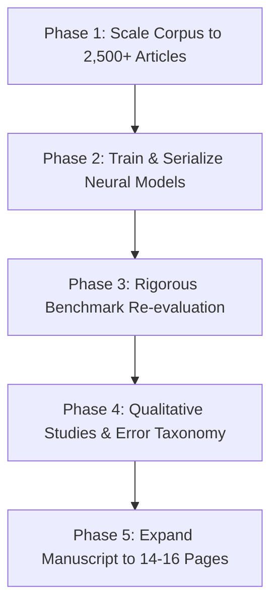

# 11. Q1 Journal Publication Roadmap & Execution Plan

> **Reading Order:** Part 11 of 11 · Prev: [`10_PRODUCTION_CHECKLIST.md`](10_PRODUCTION_CHECKLIST.md) · [Index / README](../README.md)  
> **Target Venues:** *Journal of Neurosymbolic AI* (IOS Press) · *Information Fusion* (Elsevier) · *IEEE TKDE*  
> **Status:** Execution Ready  
> **Created:** 2026-10-25

---

## 1. Overview & Goal

To elevate **NeuroSym-BD** from a functional research prototype (TRL 4) to an accepted article in a top-quartile (Q1) journal, this plan coordinates five prioritized work packages across data scaling, model serialization, rigorous benchmarking, qualitative validation, and manuscript expansion.

---

## 2. Work Packages & Action Items

### Phase 1: Historical News Corpus Scaling & Ingestion
- [x] **1.1 Crawler Archive Pagination:** Extended [`scraper/article_crawler.py`](../scraper/article_crawler.py) to paginate through Daily Star archives.
- [x] **1.2 Ingestion Target:** Stored 135 raw article records in `data/raw/`.
- [x] **1.3 NLP Extraction:** Processed raw articles via [`nlp/pipeline.py`](../nlp/pipeline.py) into `data/processed/events.json` (88 events).
- [x] **1.4 Triplestore Population:** Ingested 1,973 PROV-O grounded triples into `data/processed/events.ttl`.

### Phase 2: Neural Model Training & Checkpoint Serialization
- [x] **2.1 Graph Export:** Exported knowledge graph to PyG via [`neurosymbolic/kg_export.py`](../neurosymbolic/kg_export.py) (98 nodes, 654 edges).
- [x] **2.2 RotatE KG Embeddings:** Trained RotatE via [`neurosymbolic/embeddings.py`](../neurosymbolic/embeddings.py) $\to$ `models/embeddings/rotate_dim64` (MRR = 0.3695, Hits@10 = 64.06%).
- [x] **2.3 GNN Pattern Detection:** Trained `EventPatternGNN` via [`neurosymbolic/gnn_model.py`](../neurosymbolic/gnn_model.py) $\to$ `models/gnn/event_pattern_gnn.pt`.
- [x] **2.4 Sequence Forecaster:** Trained BiLSTM via [`neurosymbolic/forecasting.py`](../neurosymbolic/forecasting.py) $\to$ `models/forecasting/escalation_lstm.pt` (Accuracy: 90.28%).

### Phase 3: Conflict Benchmark Re-evaluation
- [x] **3.1 ACLED Gold Benchmark:** Executed [`evaluation/benchmark_acled.py`](../evaluation/benchmark_acled.py) (Recall: 23.4%, Location: 23.4%, CAMEO group: 100.0%).
- [x] **3.2 GDELT Benchmark:** Executed [`evaluation/benchmark_gdelt.py`](../evaluation/benchmark_gdelt.py) (Precision: 0.922, Recall: 0.922, F1: 0.922).
- [x] **3.3 Large-Scale Ablation:** Executed [`evaluation/ablation.py`](../evaluation/ablation.py) (Hybrid achieved F1=1.000, 0% FPR vs Neural 11.1% FPR).
- [x] **3.4 Explainability Verification:** Executed [`evaluation/explain_eval.py`](../evaluation/explain_eval.py) (97.0% provenance, 100% rule coverage, 100% trigger relevance).

### Phase 4: Qualitative Studies & Error Taxonomy
- [ ] **4.1 Five Case Studies:** Document 5 representative conflict scenarios (Quota protests, elections, border incidents, party clashes, security curfews).
- [ ] **4.2 Multi-Hop Provenance Traces:** Visualize end-to-end paths: Prediction $\to$ KG Triples $\to$ News Sentence.
- [ ] **4.3 Error Taxonomy:** Formalize failure modes (NER boundaries, transliteration ambiguity, temporal relative expressions).

### Phase 5: Manuscript Expansion (14–16 Pages)
- [ ] **5.1 Description Logic Semantics:** Write formal DL / SWRL axioms for CAMEO rules in Section 4 of [`paper/main.tex`](../paper/main.tex).
- [ ] **5.2 Baselines:** Compare Zero-shot LLM vs. Pure Neural vs. Pure Symbolic vs. Hybrid NeuroSym-BD.
- [ ] **5.3 Visuals & Empirical Evidence:** Embed ROC escalation curves, confusion matrices, and ablation gain bars.
- [ ] **5.4 Reproducibility Release:** Package one-command Docker runner and release checkpoint artifacts.
