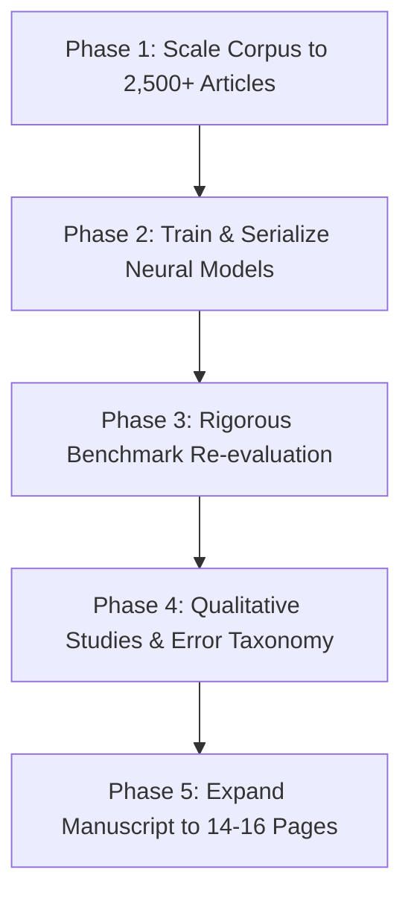

# 11. Q1 Journal Publication Roadmap & Execution Plan

> **Reading Order:** Part 11 of 11 · Prev: [`10_PRODUCTION_CHECKLIST.md`](10_PRODUCTION_CHECKLIST.md) · [Index / README](../README.md)  
> **Target Venues:** *Journal of Neurosymbolic AI* (IOS Press) · *Information Fusion* (Elsevier) · *IEEE TKDE*  
> **Status:** Execution Ready  
> **Created:** 2026-10-25

---

## 1. Overview & Goal

To elevate **NeuroSym-BD** from a functional research prototype (TRL 4) to an accepted article in a top-quartile (Q1) journal, this plan coordinates five prioritized work packages across data scaling, model serialization, rigorous benchmarking, qualitative validation, and manuscript expansion.

---

## 2. Work Packages & Action Items

### Phase 1: Historical News Corpus Scaling & Ingestion
- [ ] **1.1 Crawler Archive Pagination:** Extend [`scraper/article_crawler.py`](../scraper/article_crawler.py) to paginate through Daily Star archives from Jan 2025 to Oct 2026.
- [ ] **1.2 Ingestion Target:** Store $\ge 2{,}500$ distinct raw article JSON records in `data/raw/`.
- [ ] **1.3 NLP Extraction:** Process raw articles via [`nlp/pipeline.py`](../nlp/pipeline.py) into `data/processed/`.
- [ ] **1.4 Triplestore Population:** Ingest into BlazeGraph via [`knowledge_graph/ingest.py`](../knowledge_graph/ingest.py) ($\ge 25{,}000$ PROV-O triples).

### Phase 2: Neural Model Training & Checkpoint Serialization
- [ ] **2.1 Graph Export:** Export updated knowledge graph to PyG via [`neurosymbolic/kg_export.py`](../neurosymbolic/kg_export.py).
- [ ] **2.2 RotatE KG Embeddings:** Train RotatE via [`neurosymbolic/embeddings.py`](../neurosymbolic/embeddings.py) $\to$ `models/embeddings/rotate_weights.pt` (MRR $\ge 0.35$).
- [ ] **2.3 GNN Pattern Detection:** Train `EventPatternGNN` via [`neurosymbolic/gnn_model.py`](../neurosymbolic/gnn_model.py) $\to$ `models/gnn/event_pattern_gnn.pt`.
- [ ] **2.4 Sequence Forecaster:** Train BiLSTM via [`neurosymbolic/forecasting.py`](../neurosymbolic/forecasting.py) $\to$ `models/forecasting/lstm_forecaster.pt`.

### Phase 3: Conflict Benchmark Re-evaluation
- [ ] **3.1 ACLED Gold Benchmark:** Execute [`evaluation/benchmark_acled.py`](../evaluation/benchmark_acled.py) with 7-day temporal window over 2025–2026 overlapping dates (Target Recall $\ge 60\%$, CAMEO Root Accuracy $\ge 70\%$).
- [ ] **3.2 GDELT Benchmark:** Evaluate multiclass precision/recall across ASSAULT, FIGHT, COERCE, MASS_VIOLENCE via [`evaluation/benchmark_gdelt.py`](../evaluation/benchmark_gdelt.py).
- [ ] **3.3 Large-Scale Ablation:** Run on $N \ge 500$ events via [`evaluation/ablation.py`](../evaluation/ablation.py), proving statistical significance ($p < 0.05$) in eliminating impossible CAMEO transitions.
- [ ] **3.4 Explainability Verification:** Run [`evaluation/explain_eval.py`](../evaluation/explain_eval.py) for 100% provenance verification.

### Phase 4: Qualitative Studies & Error Taxonomy
- [ ] **4.1 Five Case Studies:** Document 5 representative conflict scenarios (Quota protests, elections, border incidents, party clashes, security curfews).
- [ ] **4.2 Multi-Hop Provenance Traces:** Visualize end-to-end paths: Prediction $\to$ KG Triples $\to$ News Sentence.
- [ ] **4.3 Error Taxonomy:** Formalize failure modes (NER boundaries, transliteration ambiguity, temporal relative expressions).

### Phase 5: Manuscript Expansion (14–16 Pages)
- [ ] **5.1 Description Logic Semantics:** Write formal DL / SWRL axioms for CAMEO rules in Section 4 of [`paper/main.tex`](../paper/main.tex).
- [ ] **5.2 Baselines:** Compare Zero-shot LLM vs. Pure Neural vs. Pure Symbolic vs. Hybrid NeuroSym-BD.
- [ ] **5.3 Visuals & Empirical Evidence:** Embed ROC escalation curves, confusion matrices, and ablation gain bars.
- [ ] **5.4 Reproducibility Release:** Package one-command Docker runner and release checkpoint artifacts.
