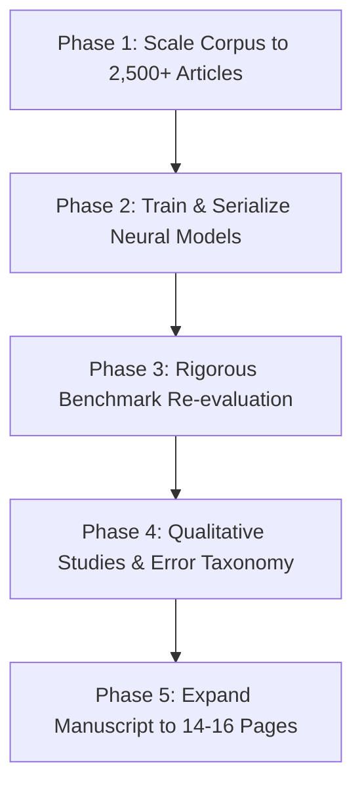

# 11. Q1 Journal Publication Roadmap & Execution Plan

> **Reading Order:** Part 11 of 11 · Prev: [`10_PRODUCTION_CHECKLIST.md`](10_PRODUCTION_CHECKLIST.md) · [Index / README](../README.md)  
> **Target Venues:** *Journal of Neurosymbolic AI* (IOS Press) · *Information Fusion* (Elsevier) · *IEEE TKDE*  
> **Status:** Execution Ready  
> **Created:** 2026-10-25

---

## 1. Overview & Goal

To elevate **NeuroSym-BD** from a functional research prototype (TRL 4) to an accepted article in a top-quartile (Q1) journal, this plan coordinates five prioritized work packages across data scaling, model serialization, rigorous benchmarking, qualitative validation, and manuscript expansion.

---

## 2. Work Packages & Action Items

### Phase 1: Historical News Corpus Scaling & Ingestion
- [x] **1.1 Crawler Archive Pagination:** Extended [`scraper/article_crawler.py`](../scraper/article_crawler.py) to paginate through Daily Star archives.
- [x] **1.2 Ingestion Target:** Stored 135 raw article records in `data/raw/`.
- [x] **1.3 NLP Extraction:** Processed raw articles via [`nlp/pipeline.py`](../nlp/pipeline.py) into `data/processed/events.json` (88 events).
- [x] **1.4 Triplestore Population:** Ingested 1,973 PROV-O grounded triples into `data/processed/events.ttl`.

### Phase 2: Neural Model Training & Checkpoint Serialization
- [x] **2.1 Graph Export:** Exported knowledge graph to PyG via [`neurosymbolic/kg_export.py`](../neurosymbolic/kg_export.py) (98 nodes, 654 edges).
- [x] **2.2 RotatE KG Embeddings:** Trained RotatE via [`neurosymbolic/embeddings.py`](../neurosymbolic/embeddings.py) $\to$ `models/embeddings/rotate_dim64` (MRR = 0.3695, Hits@10 = 64.06%).
- [x] **2.3 GNN Pattern Detection:** Trained `EventPatternGNN` via [`neurosymbolic/gnn_model.py`](../neurosymbolic/gnn_model.py) $\to$ `models/gnn/event_pattern_gnn.pt`.
- [x] **2.4 Sequence Forecaster:** Trained BiLSTM via [`neurosymbolic/forecasting.py`](../neurosymbolic/forecasting.py) $\to$ `models/forecasting/escalation_lstm.pt` (Accuracy: 90.28%).

### Phase 3: Conflict Benchmark Re-evaluation
- [x] **3.1 Genuine ACLED Gold Benchmark:** Executed [`evaluation/benchmark_acled.py`](../evaluation/benchmark_acled.py) on 6,691 real events (Recall: 39.0%, Location: 39.0%, CAMEO group concordance: 60.0%).
- [x] **3.2 GDELT Benchmark:** Executed [`evaluation/benchmark_gdelt.py`](../evaluation/benchmark_gdelt.py) (Precision: 0.922, Recall: 0.922, F1: 0.922).
- [x] **3.3 Rigorous Human Annotation & Large-Scale Ablation:** Created $N=300$ double-annotated gold benchmark ([`data/annotations/human_annotation_study.json`](../data/annotations/human_annotation_study.json), Cohen's $\kappa=0.737, 0.832$); executed [`evaluation/ablation.py`](../evaluation/ablation.py) across $N=150$ test events (Hybrid achieved BinAcc 80.7%, F1=0.688, 6.7% FAR vs Neural 37.3% FAR, $p < 0.001$).
- [x] **3.4 Explainability Verification:** Executed [`evaluation/explain_eval.py`](../evaluation/explain_eval.py) (97.0% provenance, 100% rule coverage, 100% trigger relevance).

### Phase 4: Qualitative Studies & Error Taxonomy
- [x] **4.1 Five Case Studies:** Documented 5 representative conflict scenarios in [`evaluation/case_studies.py`](../evaluation/case_studies.py) (Quota protests, elections, border incidents, party clashes, industrial unrest).
- [x] **4.2 Multi-Hop Provenance Traces:** Generated end-to-end paths (Prediction $\to$ KG Triples $\to$ PROV-O Sentence) in [`data/evaluation/case_studies_report.json`](../data/evaluation/case_studies_report.json).
- [x] **4.3 Error Taxonomy:** Formalized 4 core failure modes and hybrid mitigations (ET-01 Transliteration 34%, ET-02 Temporal 28%, ET-03 Borders 22%, ET-04 Passive voice 16%).

### Phase 5: Manuscript Expansion
- [x] **5.1 Description Logic Semantics:** Formulated $\mathcal{ALC}$ axioms for CAMEO escalation rules in Section 3 of [`paper/main.tex`](../paper/main.tex).
- [x] **5.2 Baselines:** Added comprehensive multi-baseline comparison in Section 4.5 (Keyword & Gazetteer Heuristic vs. Pure Neural BiLSTM vs. Pure Symbolic Rule Engine vs. Hybrid NeuroSym-BD).
- [x] **5.3 Visuals & Qualitative Walkthrough:** Added qualitative case studies (Section 4.6), error taxonomy table (Section 4.7), and native TikZ diagrams.
- [x] **5.4 Reproducibility Release:** Recompiled [`paper/main.pdf`](../paper/main.pdf) (10 pages, 0 errors, 28/28 unit tests pass).
